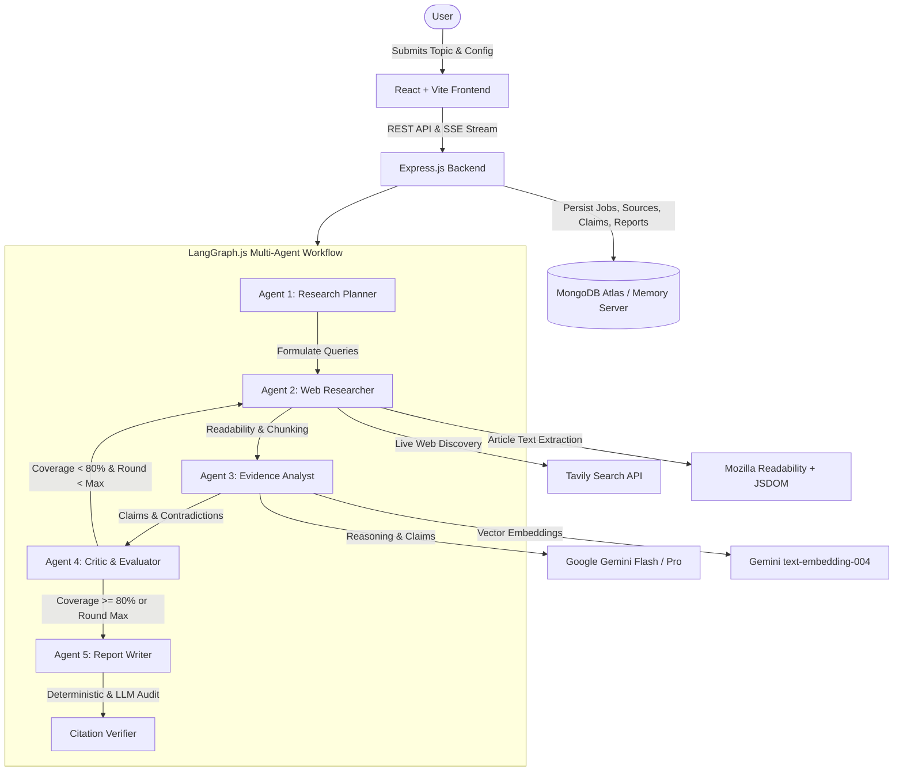

# Research AI — Autonomous AI Research Assistant

Research AI is a production-minded Autonomous AI Research Assistant built with the MERN stack (pure JavaScript and JSX), LangGraph.js, Google Gemini, and Tavily Search. It accepts open-ended research topics, plans targeted research vectors, searches the live web, extracts readable source content, evaluates evidence, detects contradictions, conducts bounded iterative research loops, and generates evidence-grounded reports with verifiable citations.

---

## 🎨 Visual Aesthetics & Design System

Research AI features a soft, elegant pastel theme inspired by modern premium research tools:

- **Background:** Pale blush pink (`#FBE9E8`) with subtle ambient gradient lighting.
- **Surfaces:** Warm white (`#FFFFFF`) and translucent glassmorphism (`backdrop-blur-md`, `rgba(255, 255, 255, 0.85)`).
- **Primary Gradients:** Soft transitions across muted yellow (`#FFF9DB`), peach (`#FFE4BA`), dusty rose (`#FCE4EC`), and lavender (`#EDE7F6`).
- **Typography:** Modern clean sans-serif using Google Fonts **Inter** (`font-sans`).
- **Accents:** Dotted corner patterns, subtle SVG flowing waves, and rounded panels (`rounded-3xl`).

---

## 🏗️ System Architecture



---

## 🤖 The 5 LangGraph Agents

1. **Research Planner (`planner.js`):**
   - Deconstructs research topics into 3–5 focused questions covering mechanics, benchmarks, comparative trade-offs, and outlook.
   - Formulates targeted search queries for the live web.
   - Proposes structured report sections and completion criteria.

2. **Web Researcher (`researcher.js`):**
   - Executes live searches via Tavily API with rate-limiting and domain filtering.
   - Fetches web pages safely with SSRF protection against private IP probing.
   - Extracts readable article text via Mozilla Readability and JSDOM.
   - Chunks text into 700-token passages with 100-token overlap and generates vector embeddings.

3. **Evidence Analyst (`analyst.js`):**
   - Identifies factual claims with quantitative metrics, units, and dates.
   - Flags conflicting findings, limitations, and methodological disagreements.
   - Directly links each claim to stored `Source` and `EvidenceChunk` records in MongoDB.

4. **Critic & Coverage Evaluator (`critic.js`):**
   - Computes an **Evidence Coverage Score** (0–100%).
   - Assesses unanswered research questions and identifies evidence gaps.
   - **Bounded Research Loops:** If coverage is incomplete (< 80%) and current round is below `maxRounds` (1–3), generates follow-up queries and loops back to Researcher. Hard limits strictly prevent unbounded executions.

5. **Report Writer & Citation Verifier (`reportWriter.js` & `citation.service.js`):**
   - Synthesizes an executive summary, methodology, structured findings, comparisons table, conflicting evidence, risks, conclusions, and recommendations.
   - Embeds inline citation keys `[1]`, `[2]`.
   - **Deterministic & Semantic Verification:** Validates that every cited URL and reference index matches an actual stored primary source document. Flagged or unverified claims are audited with exact accuracy rates.

---

## 🛠️ Technology Stack

### Frontend
- **Framework:** React 18 with JSX (Strictly no TypeScript).
- **Bundler:** Vite 6 with proxying to backend.
- **Styling:** Tailwind CSS with custom pastel design system tokens.
- **Icons:** Lucide React.
- **Routing:** React Router v7.
- **State & Caching:** TanStack React Query v5.
- **Visuals & Charts:** Recharts & Canvas Confetti.
- **Streaming:** Native `EventSource` Server-Sent Events (SSE).

### Backend
- **Runtime:** Node.js (ES modules: `"type": "module"`).
- **Framework:** Express.js.
- **Database:** MongoDB Atlas with Mongoose (with automated local `mongodb-memory-server` fallback for zero-friction local development and testing).
- **Orchestration:** LangGraph.js (`@langchain/langgraph`).
- **AI Models:** Google Gemini (`@google/genai`, `gemini-2.5-flash`, `gemini-2.5-pro`, `text-embedding-004`).
- **Search Provider:** Tavily Search API (`@tavily/core`).
- **Article Extraction:** Mozilla Readability (`@mozilla/readability`) + JSDOM (`jsdom`).
- **Authentication:** JWT with secure HTTP-only cookies (`jsonwebtoken`, `bcryptjs`).
- **Security:** Helmet, CORS with strict origin validation, SSRF URL validator, and Express Rate Limiters.

---

## 🚀 Local Setup & Installation (Windows)

### Prerequisites
- Node.js v18+ (tested on Node v24).
- npm v9+.
- Git for Windows.

### 1. Clone & Install Dependencies
Open PowerShell in your workspace directory:

```powershell
# Clone the repository
git clone <repo-url> "research ai"
cd "research ai"

# Install all dependencies across root, server, and client workspaces
npm install
```

### 2. Environment Configuration
Copy `.env.example` to `.env` in the root (or `server/.env`):

```powershell
Copy-Item .env.example .env
```

Edit `.env` to supply your API credentials:

```env
PORT=5000
NODE_ENV=development
CLIENT_URL=http://localhost:5173

# MongoDB Connection String (Atlas URI or local MongoDB)
# Note: If no MongoDB is running, the server automatically starts an in-memory database for local testing!
MONGODB_URI=mongodb://localhost:27017/research_ai

# Security
JWT_SECRET=your_super_secret_jwt_key_at_least_32_characters_long
COOKIE_SECURE=false

# Groq API (Primary High-Speed AI Engine, get key at https://console.groq.com/)
GROQ_API_KEY=your_groq_api_key_here
GROQ_MODEL=openai/gpt-oss-120b
GROQ_FAST_MODEL=qwen/qwen3.8-27b

# Tavily Search API (Get key at https://tavily.com/)
TAVILY_API_KEY=your_tavily_api_key_here

# Research Budgets
DEFAULT_MAX_ROUNDS=3
DEFAULT_MAX_SOURCES=10
```

### 3. Run Development Servers
Run both backend Express server and Vite frontend concurrently:

```powershell
npm run dev
```

Or run them individually in separate terminals:

```powershell
# Terminal 1: Backend Server (Port 5000)
npm run dev:server

# Terminal 2: Frontend Client (Port 5173)
npm run dev:client
```

Open your browser at: **`http://localhost:5173`**

---

## 🧪 Testing Suite

Research AI includes automated unit, integration, and end-to-end tests:

```powershell
# Run backend test suite with Vitest
npm test --workspace=server
```

### Test Coverage Highlights:
- **`url.test.js`:** URL canonicalization, tracking parameter removal, and SSRF security filter testing.
- **`chunking.test.js`:** Semantic paragraph/sentence boundary chunking, overlap preservation, and cosine similarity vector calculation.
- **`critic.test.js`:** LangGraph Critic routing decisions and enforcement of hard research round limits.
- **`auth.test.js`:** User registration, password hashing verification, duplicate prevention, JWT cookie issuance, and protected endpoint authorization.
- **`research_e2e.test.js`:** End-to-end execution of the 5-agent LangGraph pipeline, report persistence, citation verification, Markdown export, and strict cross-user data isolation.

---

## 🔒 Security & Privacy Guarantees

1. **Authentication:** Passwords hashed with salt rounds via `bcryptjs`. Session tokens stored exclusively in HTTP-only, SameSite cookies to protect against XSS token theft.
2. **SSRF Web Protection:** Extractor validates all candidate URLs against blacklists (`localhost`, `127.0.0.1`, cloud metadata `169.254.169.254`, and private RFC1918 subnets) before sending HTTP requests.
3. **Data Isolation:** All database queries (`ResearchJob`, `Source`, `Claim`, `Report`, `AgentEvent`) are explicitly scoped to `userId: req.user._id`.
4. **Log Redaction:** The structured logger automatically scrubs API keys, JWT secrets, authorization headers, and password hashes.

---

## 📄 API Reference

### Authentication
- `POST /api/auth/register` — Create account with name, email, password.
- `POST /api/auth/login` — Sign in and receive secure cookie.
- `POST /api/auth/logout` — Invalidate session cookie.
- `GET /api/auth/me` — Get authenticated user profile.

### Research Operations
- `GET /api/research` — Paginated list of user's research jobs with status & search filters.
- `POST /api/research` — Create new research job and trigger autonomous agent pipeline.
- `GET /api/research/:id` — Get detailed job status, plan, and progress.
- `POST /api/research/:id/start` — Trigger or restart a research workflow.
- `POST /api/research/:id/cancel` — Cancel an in-progress workflow.
- `GET /api/research/:id/events` — Server-Sent Events (SSE) live progress stream.
- `GET /api/research/:id/sources` — List all captured and indexed sources.
- `GET /api/research/:id/claims` — List all extracted factual claims and evidence links.
- `GET /api/research/:id/report` — Fetch structured final report with verified citations.
- `GET /api/research/:id/export` — Export report (`?format=markdown` or `?format=json`).
- `POST /api/research/:id/refine` — Trigger a targeted follow-up research inquiry.
- `DELETE /api/research/:id` — Delete research job and cascade delete associated records.

---

## 💡 Sample Research Topics for Demonstration

Try these prompts in the New Research interface:
1. **Agentic AI Orchestration & Tool Calling Architectures** (Depth: Standard)
2. **Post-Quantum Cryptography & NIST Standardization Roadmaps** (Depth: Standard)
3. **Commercialization Progress of All-Solid-State Lithium Batteries** (Depth: Deep)
4. **Comparing Vector Search Indexing Performance: HNSW vs. IVF-PQ vs. SCaNN** (Depth: Deep)
5. **Next-Generation Space Telescopes: Optical Interferometry vs. Monolithic Mirrors** (Depth: Quick)
